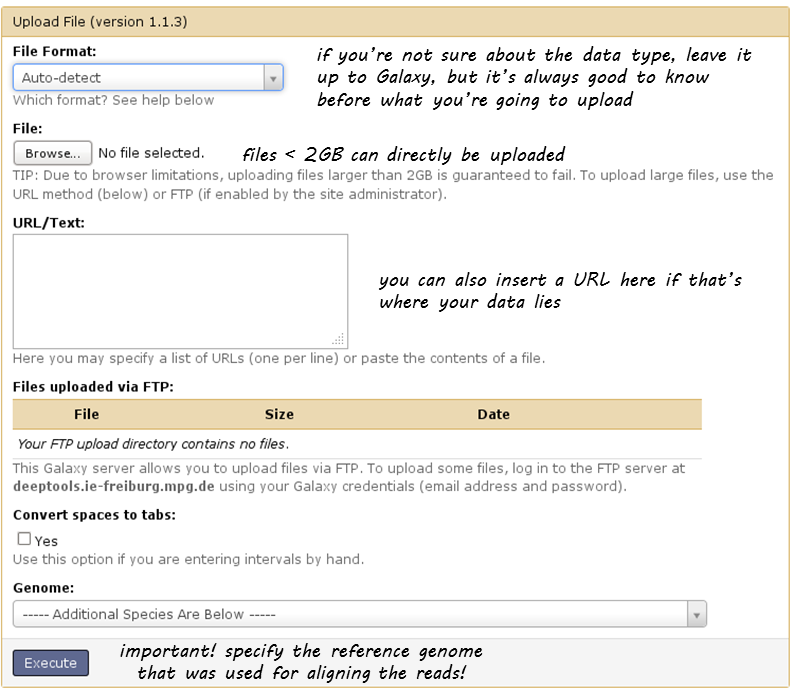
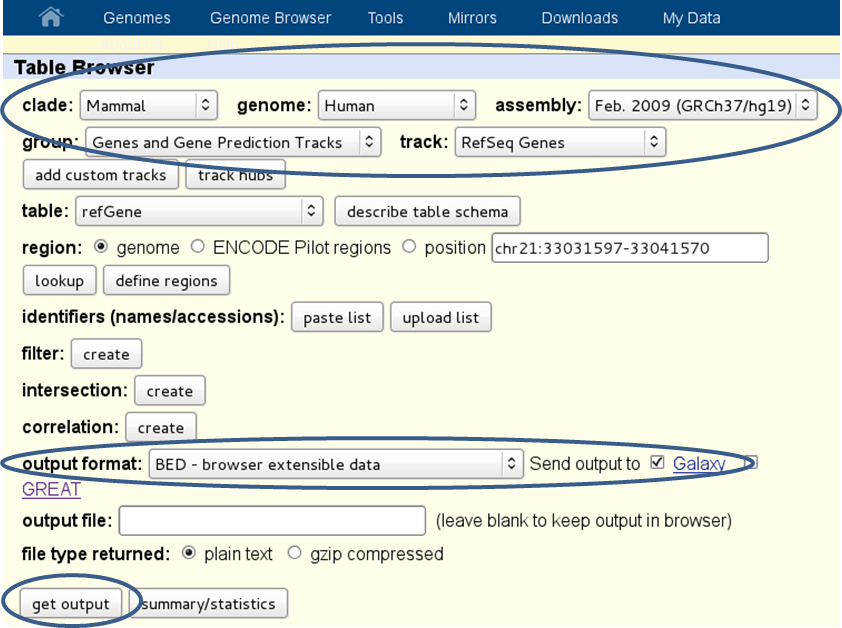
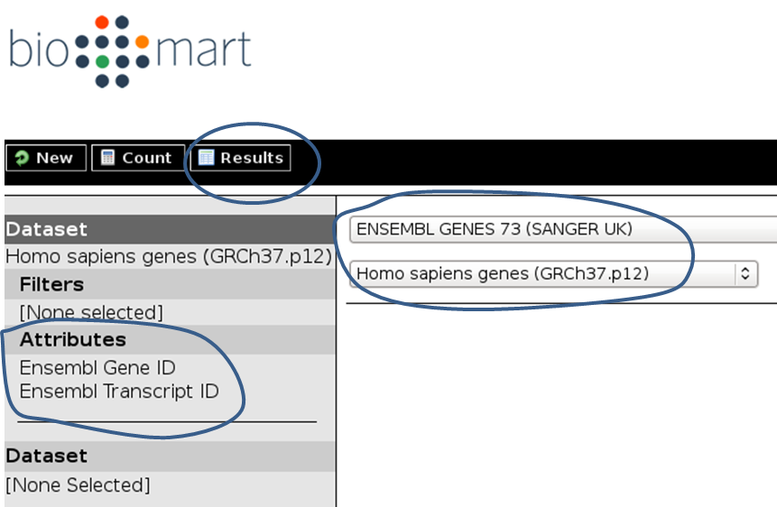
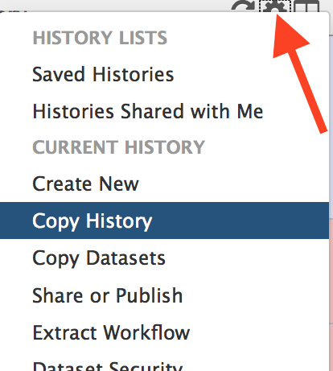

Data import into Galaxy
-------------------------

There are two main ways to populate your Galaxy history with data
files plus an additional one for sharing data within Galaxy.

.. contents:: 
    :local:

Upload files from your computer
^^^^^^^^^^^^^^^^^^^^^^^^^^^^^^^^^

The data upload of files **smaller than 2 GB** that lie on your computer is fairly straight-forward: click on the category "Get data" and choose the tool "Upload file".
Then select the file via the "Browse" button.

Download annotation files from public data bases
^^^^^^^^^^^^^^^^^^^^^^^^^^^^^^^^^^^^^^^^^^^^^^^^^

In many cases you will want to query your sequencing data results for
known genome annotation, such as genes, exons, transcription start sites
etc. These information can be obtained via the two main sources of
genome annotation, `UCSC <http://genome.ucsc.edu/>`__ and `BioMart <http://www.biomart.org/>`__.

.. warning:: UCSC and BioMart cater to different ways of genome annotation, i.e. genes defined in UCSC might not correspond to the same regions in a gene file downloaded from BioMart. (For a brief overview over the issues of genome annotation, you can check out `Wikipedia <http://en.wikipedia.org/wiki/Genome_project>`_, if you always wanted to know much more about those issues, `this <http://www.ncbi.nlm.nih.gov/pubmed/22510764>`_ might be a good start.)

You can access the data stored at UCSC or BioMart conveniently through Galaxy, which will import the resulting files into your history. Just go to **"Get data"** ⟶ "UCSC" or "BioMart".

The majority of annotation files will probably be in [BED][] format, however, you can also find other data sets.
UCSC, for example, offers a wide range of data that you can browse via the "group" and "track" menus (for example, you could download the GC content of the genome as a signal file from UCSC via the "group" menu ("Mapping and Sequencing Tracks").

.. warning:: The download through this interface is limited to 100,000 lines per file which might not be sufficient for some mammalian data sets.

Here's a screenshot from downloading a BED-file of all RefSeq genes defined for the human genome (version hg19):

And here's how you would do it for the BioMart approach:

.. tip:: Per default, **BioMart will not output a BED file** like UCSC does. It is therefore important that you make sure you get all the information you need (most likely: chromosome, gene start, gene end, ID, strand) via the "Attributes" section. You can click on the "Results" button at any time to check the format of the table that will be sent to Galaxy (Note that the strand information will be decoded as 1 for "forward" or "plus" strand and -1 for "reverse" or "minus" strand).

.. warning:: Be aware, that BED files from UCSC will have chromosomes labelled with “chr” while ENSEMBL usually returns just the number – this might lead to incompatibilities, i.e. when working with annotations from UCSC and ENSEMBL, you need to make sure to use the same naming!

Copy data sets between histories
^^^^^^^^^^^^^^^^^^^^^^^^^^^^^^^^^^^^^^^
 
If you are logged in to your Galaxy server you can have more than one history.

In order to minimize the disk space you're occupying we strongly suggest to **copy** data sets between histories when you're using the same data set in different histories.

.. note:: Copying data sets is only possible for registered users.

Copying can easily be done via the History panel's ``option`` button ⟶ "Copy dataset". In the main frame, you should now be able to select the history you would like to copy from on the left hand side and the target history on the right hand side.

**More help**

.. hint:: If you encounter a failing data set (marked in red), please **send a bug report** to the administrators of your Galaxy server via the Galaxy bug report button.

+--------------------------------------------------------------------------------+-----------------------------------------------------------------+
| `Galaxy Training Network <https://training.galaxyproject.org/>`__              | Help for Galaxy usage in general                                |
+--------------------------------------------------------------------------------+-----------------------------------------------------------------+
| :doc:`help_faq_galaxy`                                                         | Frequently encountered issues with deepTools in Galaxy          |
+--------------------------------------------------------------------------------+-----------------------------------------------------------------+
| `Biostars <http://biostars.org>`__                                             | For issues not addressed in the FAQs                            |
+--------------------------------------------------------------------------------+-----------------------------------------------------------------+
